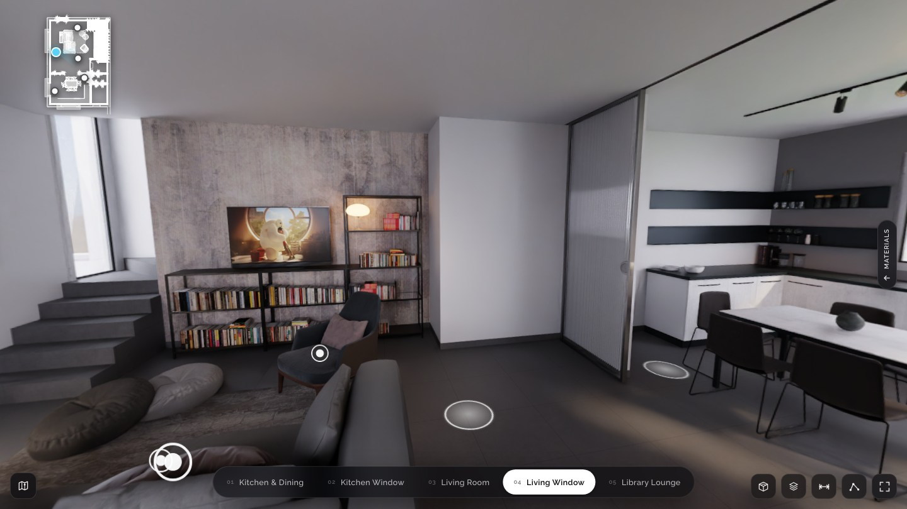

# MeshTour

[![Core on npm][core-badge]][core-npm]
[![React on npm][react-badge]][react-npm]
[![MIT license][license-badge]](LICENSE)

MeshTour is a Three.js library for walking between 360° panoramas. It projects
the images onto a mesh of the room so nearby objects shift as the camera moves
and walls can hide hotspots.

[Try Italian Flat](https://meshtour-demo.vercel.app/) ·
[Tour config](docs/CONFIG.md) ·
[Blender export guide](assets-pipeline/BLENDER.md)



## Use it

```sh
npm install @meshtour/core three
```

Give your page a container with a height, such as
`<div id="tour" style="height: 70vh"></div>`.

```js
import { TourEngine } from "@meshtour/core";

const tour = new TourEngine({
  container: document.getElementById("tour"),
  config: "/tours/apartment/tour.json",
});

await tour.start();
```

A tour config points to a GLB mesh and a panorama for each viewpoint.
See the [bundled tour](apps/demo/public/tours/italian-flat/tour.json) for an example.

For React, install `@meshtour/react` alongside Core and use the
[Tour component](packages/react/README.md).

## Run the demo locally

Use Node.js 22 and pnpm 9.15.4 from the repository root.

```sh
pnpm install --frozen-lockfile
pnpm build
pnpm --filter @meshtour/demo dev
```

Add `?author=1` to the local URL to place hotspots, edit links, or check
panorama alignment. See [CONTRIBUTING.md](CONTRIBUTING.md) for test commands.

## License

The code is [MIT](LICENSE). Flavio Della Tommasa made the
[Italian Flat scene](apps/demo/public/tours/italian-flat/ATTRIBUTION.md), which
is licensed separately under CC BY.

[core-badge]: https://img.shields.io/npm/v/@meshtour/core?label=core
[core-npm]: https://www.npmjs.com/package/@meshtour/core
[react-badge]: https://img.shields.io/npm/v/@meshtour/react?label=react
[react-npm]: https://www.npmjs.com/package/@meshtour/react
[license-badge]: https://img.shields.io/badge/license-MIT-blue
