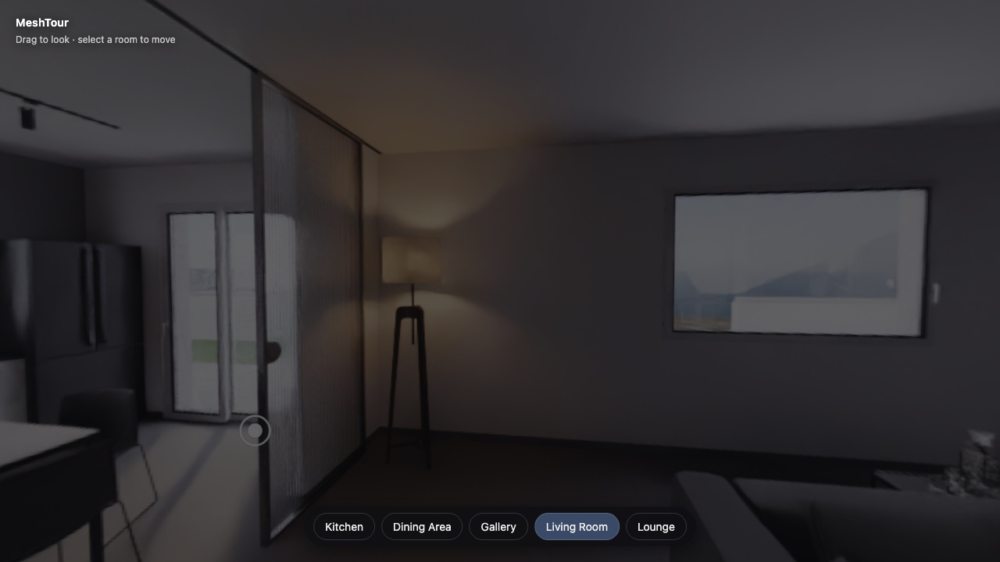

# MeshTour

**Open-source mesh-backed virtual tours for the web.** Photorealistic equirectangular panoramas projected onto an invisible low-poly proxy mesh — so your tour knows what the cursor is pointing at, hides hotspots behind walls, and _walks_ between viewpoints with a parallax-correct transition instead of a crossfade.

> Status: Stage 1 (v0.1 release candidate). Core engine, React bindings, author mode, and a production-asset demo. Config schema v1.



[Watch the 14-second walking-transition demo](docs/media/meshtour-transition.webm)

## Why a mesh behind the image?

Flat panorama viewers (Pannellum, Marzipano, krpano, Kuula) display a sphere of pixels. MeshTour renders the same pixels **projected onto real 3D geometry** of the space, which unlocks:

- **Object-aware cursor** — hover a table, wall, or apartment unit to highlight it, change the cursor, or show a tooltip.
- **Occlusion-aware hotspots** — a hotspot behind a wall is hidden, exactly as it should be.
- **Walking transitions** — the camera moves through real 3D space between viewpoints while panoramas re-project onto the mesh. This is the signature feature.
- **WebXR / VR mode** — headset pose is calibrated to each panorama node, with controller-ray hotspot selection and comfort teleports.
- **Pre-rendered furniture variants** — transparent per-node panorama layers can replace an interactable's finish while retaining offline-rendered lighting and transition alignment.

The closest commercial analogue is Matterport, but MeshTour's primary workflow is **same-source**: panoramas _and_ proxy mesh are exported from one 3D model (Blender, 3ds Max…), so alignment is exact and free. That makes it uniquely suited to **pre-construction real estate and archviz** — spaces that don't physically exist yet and cannot be scanned.

## Packages

| Package                             | Purpose                                              |
| ----------------------------------- | ---------------------------------------------------- |
| [`@meshtour/core`](packages/core)   | Framework-agnostic engine (three.js peer dependency) |
| [`@meshtour/react`](packages/react) | `<Tour>` component + `useTour()` hook wrapping core  |

## Quickstart (React)

```bash
npm install @meshtour/react @meshtour/core three
```

```tsx
import { Tour } from "@meshtour/react";

export function Apartment() {
  return (
    <Tour
      config="/tours/apartment/tour.json"
      style={{ height: "100dvh" }}
      onNodeChange={(id) => console.log("now at", id)}
      onHotspotClick={(hotspot) => console.log(hotspot.title)}
    />
  );
}
```

## Quickstart (vanilla JS)

```ts
import { TourEngine } from "@meshtour/core";

const engine = new TourEngine({
  container: document.getElementById("tour")!,
  config: "/tours/apartment/tour.json",
});
await engine.start();

engine.on("nodechange", ({ to }) => console.log("now at", to));
await engine.goToNode("kitchen"); // animated walking transition
```

## The tour config

A tour is one JSON file — the full format is documented in [CONFIG.md](docs/CONFIG.md):

```jsonc
{
  "version": 1,
  "name": "Demo Apartment",
  "assets": { "mesh": { "url": "mesh/apartment.glb", "draco": true } },
  "nodes": [
    {
      "id": "living_room",
      "position": [2.1, 1.6, -3.4],
      "panorama": { "url": "pano/living_room", "yaw": 1.5708 },
      "links": [{ "to": "kitchen", "position": [3.8, 0.02, -2.2] }],
    },
  ],
  "start": "living_room",
}
```

## Producing assets

The Blender same-source workflow (panorama cameras + decimated proxy mesh + KTX2 compression) is documented step-by-step in [assets-pipeline/BLENDER.md](assets-pipeline/BLENDER.md).

The bundled demo uses the freely licensed **Italian Flat** scene by Flavio Della Tommasa. Its three repositioned 4K panoramas, detailed contour-accurate Draco proxy, progressive KTX2 delivery, attribution, and reproducible build notes live under `apps/demo/public/tours/italian-flat/`; see [the asset runbook](docs/FIRST_DEMO_ASSETS.md).

## Author mode

Pass `authorMode: true` (or the `authorMode` prop) to get an in-canvas debug overlay: toggle the proxy wireframe to verify alignment, click to place hotspots and links, drag either marker along surfaces, nudge per-panorama yaw, and copy/download the updated JSON. No backend, no persistence — paste the JSON into your tour file.

The bundled demo enables this panel when opened with `?author=1`, making the
entire authoring workflow inspectable without changing source code.

## Feature comparison

|                                       | MeshTour | Pannellum / Marzipano | Matterport       |
| ------------------------------------- | -------- | --------------------- | ---------------- |
| Open source                           | ✅ MIT   | ✅                    | ❌ SaaS          |
| Walking transition (parallax-correct) | ✅       | ❌ crossfade/zoom     | ✅               |
| Object-aware hover                    | ✅       | ❌                    | partial          |
| Occlusion-aware hotspots              | ✅       | ❌                    | ✅               |
| Works for unbuilt spaces (renders)    | ✅       | ✅ (flat)             | ❌ requires scan |
| Self-hosted                           | ✅       | ✅                    | ❌               |

## Monorepo layout

```
packages/core       @meshtour/core — the engine
packages/react      @meshtour/react — React bindings
apps/demo           production-asset React demo (pnpm --filter @meshtour/demo dev)
assets-pipeline     Blender export guide and reproducible reference scripts
docs                CONFIG.md and friends
```

The demo serves checked-in, optimized assets produced from the licensed Blender scene; Draco and Basis decoders are self-hosted, so it has no runtime CDN dependency.

## Development

```bash
pnpm install
pnpm build        # build the publishable packages
pnpm test         # unit tests (config schema, projection math, events)
pnpm typecheck
pnpm test:e2e     # Chromium flows/visuals + Firefox/WebKit compatibility
```

Package versioning uses Changesets. Maintainer setup and first-publish checks
are documented in [RELEASING.md](docs/RELEASING.md). A developer taking over
the project should start with [DEVELOPER_HANDOFF.md](docs/DEVELOPER_HANDOFF.md).
Reproducible cold-start and transition measurements are in
[PERFORMANCE.md](docs/PERFORMANCE.md).

## Known rendering artifacts (and what we do about them)

- **Sparse transition coverage**: walk mode uses conservatively filtered,
  confidence-weighted radial depth to stop a panorama from painting surfaces
  hidden from its capture point. Tours may provide a separate
  `assets.visibilityMesh`, precomputed per-node KTX2 depth, and a baked
  `assets.bridge` for true disocclusions; the interaction proxy and runtime
  depth capture remain the v1-compatible fallback. Use
  `rendering.transition: "fade"` for deliberately sparse tours.
- **Proxy imprecision**: where the low-poly mesh deviates from the rendered geometry, texels swim slightly during movement. Keep walls/floors/large furniture reasonably faithful when decimating.
- **Equirect seam/poles**: handled with derivative-aware dual sampling in the shader.

The staged engineering plan for eliminating the remaining walk artifacts is in
[TRANSITION_QUALITY.md](docs/TRANSITION_QUALITY.md).

## Roadmap

- Calibration tooling for photographed panoramas of real spaces
- Offline depth-map import for scan/photo workflows
- Dollhouse view, minimap, floor plans
- Stage 2: hosted visual editor producing this same config format

## License

[MIT](LICENSE)
